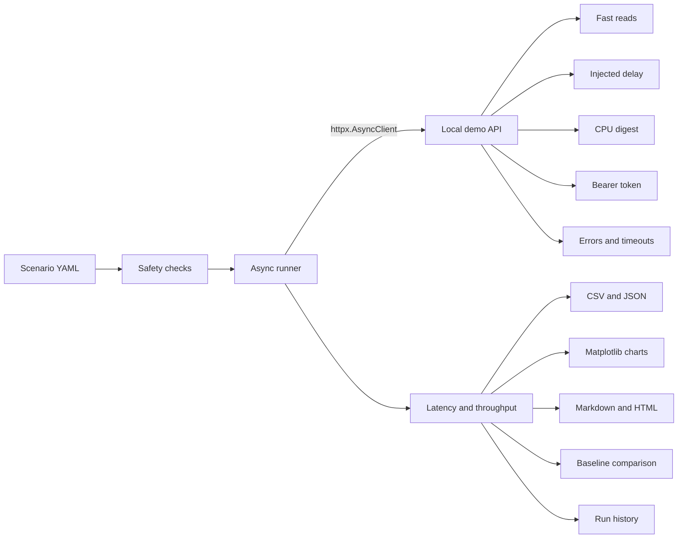
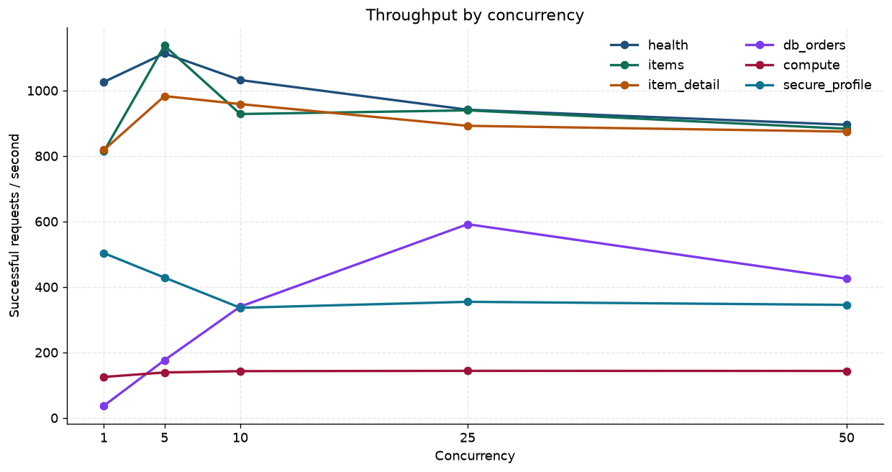
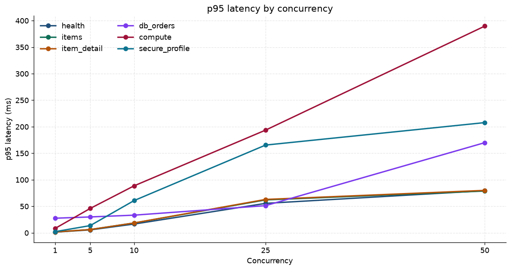
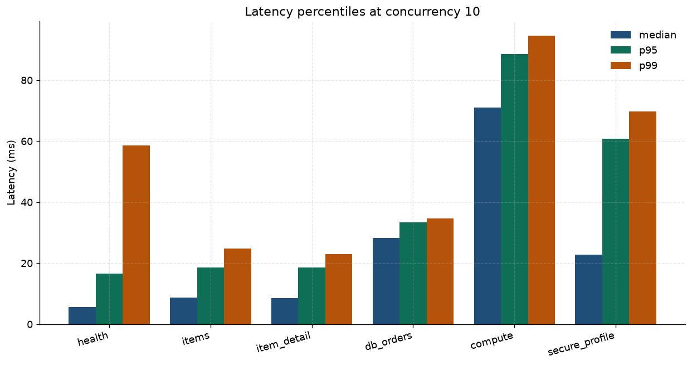
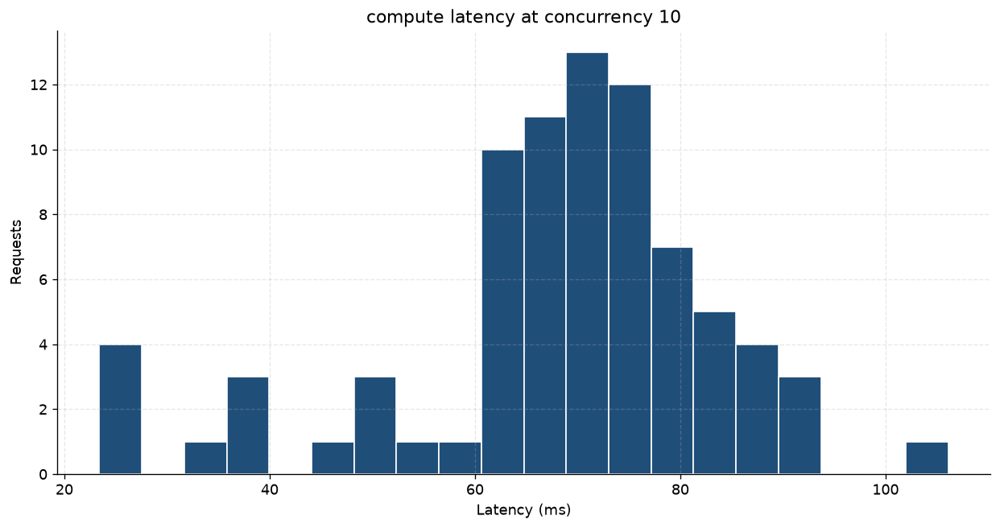
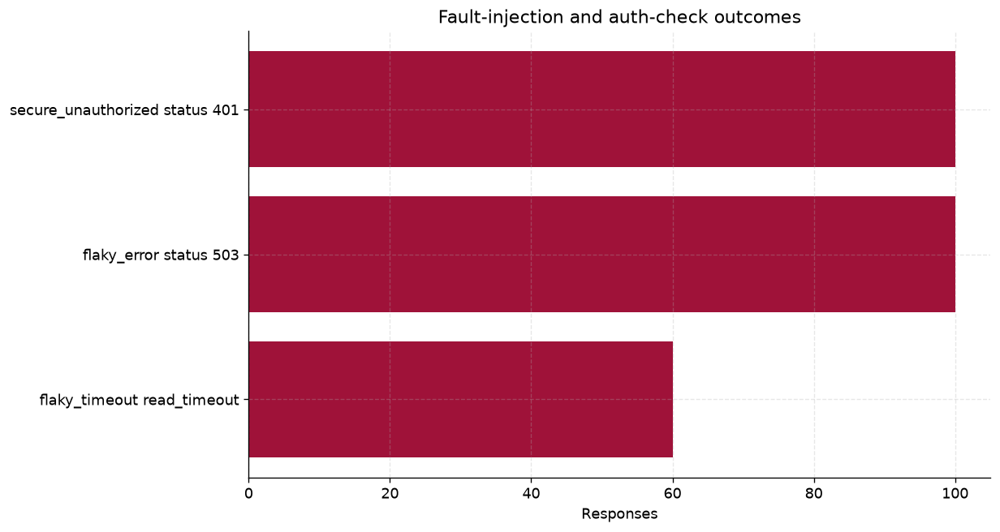
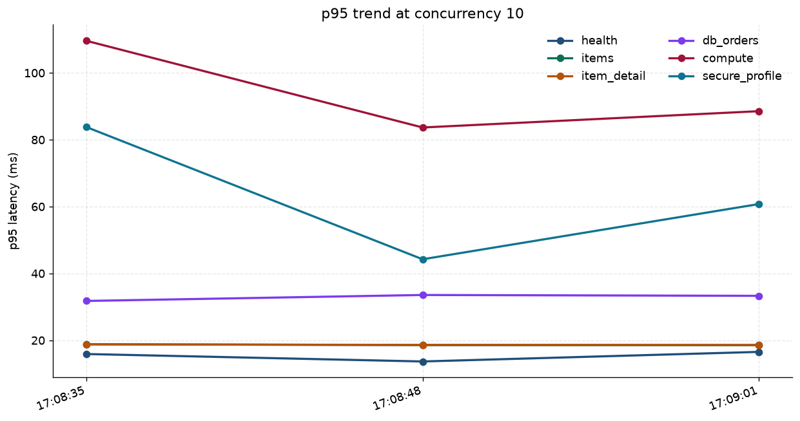

# Async API Performance Benchmarking

[](https://github.com/hassanmehmoodd/python-api-performance-benchmarking/actions/workflows/ci.yml)
[](https://www.python.org/downloads/)
[](https://fastapi.tiangolo.com/)
[](https://docs.astral.sh/ruff/)
[](LICENSE)

Async HTTP benchmark for services you own or are authorized to test. A local FastAPI demo is the default target. The runner sweeps concurrency, records latency percentiles and throughput, classifies timeouts and HTTP errors, compares a run with a saved baseline, and writes CSV, JSON, Matplotlib charts, and Markdown and HTML reports.

## Safety

Benchmark only systems you own or are explicitly authorized to test.

The default host allowlist is `localhost`, `127.0.0.1`, and `::1`. A run aimed at any other host requires both of these:

- `BENCH_ALLOW_REMOTE=1`
- an acknowledgement: `--acknowledge-remote` or `BENCH_ACKNOWLEDGE_REMOTE=1`

Concurrency is capped (default 100, hard ceiling 200). A single endpoint and concurrency level can schedule at most 5,000 requests, and a scenario can schedule at most 100,000 including warmup and the token call. The demo API binds to `127.0.0.1` unless `DEMO_API_HOST` is changed. The fixed demo token in `demo_api/app.py` is a local fixture. Do not reuse it anywhere else.

## Features

- Asynchronous HTTP calls with `httpx.AsyncClient`
- In-flight concurrency controlled with an `asyncio` semaphore
- Configurable concurrency sweeps
- Multiple endpoints in one scenario
- Token acquisition, bearer calls, and an unauthorized check
- Latency average, median, p90, p95, p99, min, and max
- Throughput compared across endpoints and concurrency levels
- Connect, read, write, and pool timeouts categorized separately
- Status and exception breakdowns
- Run history and a p95 trend chart
- Baseline comparison with a percent threshold and an absolute floor
- CSV and JSON exports
- Matplotlib charts
- Markdown and HTML reports

## Architecture

One client is shared for the run so keep-alive is real. The connection pool is sized to the largest concurrency level. Each level then admits at most that many requests through a semaphore. Warmup calls are discarded. Latency percentiles use successful responses only (the status was expected and no exception was raised). Throughput is successes divided by the wall-clock time of that cell. Percentiles use linear interpolation at rank `(n - 1) * p / 100`, the same definition as NumPy's default linear method.

A latency regression is flagged when p95 grows by more than the percent threshold and by more than the absolute floor (defaults: 20% and 5 ms). Throughput uses the same two-part rule in the other direction (defaults: 15% and 1 request/s). The floor keeps sub-millisecond jitter from looking like a regression.



## Layout

```
bench/                  runner, safety limits, stats, exports, charts, reports
demo_api/               local FastAPI target
scenarios/smoke.yaml    short sweep used by CI
scenarios/portfolio.yaml sample sweep documented below
tests/                  pytest suite
results/samples/        measured sample run, charts, and history
.github/workflows/ci.yml
pyproject.toml
```

Other output directories under `results/` are gitignored. `results/samples/` is the published run.

## Install

Python 3.11 or newer.

```bash
python3 -m venv .venv
source .venv/bin/activate
pip install -e ".[dev]"
```

## Run the demo API

```bash
uvicorn demo_api.app:app --host 127.0.0.1 --port 8000 --no-access-log
```

`demo-api` starts the same application. The default bind address is loopback.

| Method | Path | Cost |
| --- | --- | --- |
| GET | `/health` | Fast read |
| GET | `/api/items` | Fast list |
| GET | `/api/items/{item_id}` | Fast read by id |
| GET | `/api/db/orders?delay_ms=` | Fixed payload after an injected wait |
| GET | `/api/compute/digest?rounds=` | SHA-256 loop on the FastAPI thread pool |
| POST | `/auth/token` | Local username and password, returns a bearer token |
| GET | `/api/secure/profile` | Requires `Authorization: Bearer` |
| GET | `/api/flaky` | `mode=ok`, `mode=error`, or `mode=slow` with a delay |

The local credentials are username `demo` and password `demo-pass`. They exist only so the demo can issue `local-demo-token`.

## Run a benchmark

Smoke sweep, the same one CI runs:

```bash
python -m bench run \
  --scenario scenarios/smoke.yaml \
  --output-dir results/smoke
```

Portfolio sweep, then a later run compared with the saved baseline:

```bash
python -m bench run \
  --scenario scenarios/portfolio.yaml \
  --output-dir results/latest \
  --history-dir results/history \
  --save-baseline results/baseline.json

python -m bench run \
  --scenario scenarios/portfolio.yaml \
  --output-dir results/latest \
  --history-dir results/history \
  --compare-baseline results/baseline.json
```

Each `run` writes `summary.json`, `summary.csv`, `report.md`, `report.html`, and `charts/`. `--fail-on-regression` exits 3 when a compared metric crosses a threshold. Exit 2 means an endpoint that was expected to succeed recorded zero successes. Exit 1 means the scenario was refused or token acquisition failed.

Compare two files that were already written:

```bash
python -m bench compare \
  --baseline results/baseline.json \
  --current results/latest/summary.json
```

## Configuration

Scenario fields:

| Field | Meaning |
| --- | --- |
| `base_url` | Target origin. Localhost is allowed by default. |
| `concurrency_levels` | Sweep, for example `[1, 5, 10, 25, 50]` |
| `requests_per_level` | Default request count for each cell |
| `timeout_seconds` | Connect, read, write, and pool budget |
| `warmup_requests` | Discarded calls per endpoint before the sweep |
| `auth` | `token_path`, `username`, and `password` for one token fetch |
| `endpoints[].auth` | Send the bearer token |
| `endpoints[].expected_statuses` | Statuses counted as success |
| `endpoints[].timeout_seconds` | Per-endpoint timeout override |
| `endpoints[].requests` | Per-endpoint count override |
| `endpoints[].role` | `performance`, `auth_check`, or `fault` |
| `endpoints[].allow_zero_success` | Keep exit code 0 when every call fails on purpose |

Environment variables, also listed in `.env.example`:

| Variable | Default | Meaning |
| --- | --- | --- |
| `BENCH_ALLOWED_HOSTS` | `localhost,127.0.0.1,::1` | Case-insensitive allowlist |
| `BENCH_MAX_CONCURRENCY` | `100` | Cap for a concurrency level. Cannot exceed 200. |
| `BENCH_ALLOW_REMOTE` | unset | Required, with an acknowledgement, for any other host |
| `BENCH_ACKNOWLEDGE_REMOTE` | unset | Alternative to `--acknowledge-remote` |
| `DEMO_API_HOST` | `127.0.0.1` | Demo bind address |
| `DEMO_API_PORT` | `8000` | Demo port |

## Sample run

The tables and charts below are the third consecutive run of `scenarios/portfolio.yaml` against the local demo. The baseline is the first of those three runs. The trend chart includes all three. Raw samples for the published run are in [`results/samples/summary.json`](results/samples/summary.json). The full generated report is [`results/samples/report.md`](results/samples/report.md).

Measured on the cloud agent VM that built this repository (hostname `cursor`):

| | |
| --- | --- |
| Run | `20261108T170901652588Z` |
| Window | 2026-11-08T17:09:01.652Z to 2026-11-08T17:09:13.278Z |
| Python | CPython 3.12.3 |
| Platform | Linux-6.12.113+-x86_64-with-glibc2.39 |
| CPU | Intel(R) Xeon(R) Processor, 4 logical CPUs |
| Server | one uvicorn process, `127.0.0.1:8000`, access log off |
| Workload | concurrency 1, 5, 10, 25, 50; 80 requests per performance cell; 5 warmup calls per endpoint discarded |

These numbers describe that process on that machine.

Token acquisition took 16.93 ms. Highest p95 in the published run was `compute` at concurrency 50: 389.63 ms. Lowest p95 was `health` at concurrency 1: 1.31 ms. Highest throughput was `items` at concurrency 5: 1136.9 requests/s.

| Endpoint | p95 @ 1 | p95 @ 10 | p95 @ 50 | RPS @ 1 | RPS @ 10 | RPS @ 50 |
| --- | ---: | ---: | ---: | ---: | ---: | ---: |
| health | 1.31 | 16.51 | 79.43 | 1026.0 | 1031.7 | 895.3 |
| items | 1.60 | 18.53 | 78.75 | 813.7 | 928.0 | 883.0 |
| item_detail | 1.54 | 18.58 | 80.00 | 818.1 | 958.4 | 874.3 |
| db_orders | 27.50 | 33.28 | 169.94 | 36.9 | 339.9 | 424.9 |
| compute | 8.32 | 88.52 | 389.63 | 125.0 | 142.7 | 143.3 |
| secure_profile | 2.21 | 60.74 | 207.75 | 503.1 | 336.2 | 345.0 |

Latency is milliseconds. On this single worker:

- `db_orders` sleeps 25 ms. At concurrency 1 the median was 27.02 ms and throughput was 36.9 requests/s. Throughput then rose to 591.5 requests/s at concurrency 25 (p95 51.22 ms) and fell to 424.9 requests/s at concurrency 50, where p95 was 169.94 ms.
- `compute` runs 20,000 SHA-256 rounds. Throughput stayed between 125.0 and 143.5 requests/s while p95 moved from 8.32 ms to 389.63 ms. Added concurrency queued CPU work.
- `health` throughput ran from 1113.4 requests/s at concurrency 5 to 895.3 requests/s at concurrency 50. Its p95 moved from 1.31 ms at concurrency 1 to 79.43 ms at concurrency 50. At concurrency 10 the health p99 was 58.63 ms against a p95 of 16.51 ms.
- `secure_profile` at concurrency 1 did 503.1 requests/s with p95 2.21 ms. At concurrency 50 its p95 was 207.75 ms.

Auth and fault checks in the same run:

| Endpoint | Calls | Observed outcome |
| --- | ---: | --- |
| secure_unauthorized | 100 | HTTP 401 on every call |
| flaky_error | 100 | HTTP 503 on every call, which is the expected status |
| flaky_timeout | 60 | `read_timeout` on every call (0.1 s client budget, 500 ms server delay) |

`flaky_error` has error rate 0% in the results table because 503 is the expected status. The chart below still counts those responses. `flaky_timeout` is allowed to record zero successes, so the command exits 0.

Compared with the baseline saved from the first run, using the default thresholds (p95 increase of 20% and 5 ms, throughput drop of 15% and 1 request/s): no metric regressed. Two latency improvements crossed both thresholds: `compute` at concurrency 50, 489.37 ms to 389.63 ms (-20.4%), and `secure_profile` at concurrency 10, 83.78 ms to 60.74 ms (-27.5%).













The three history points are 17:08:35, 17:08:48, and 17:09:01 UTC on 2026-11-08. Files are under [`results/samples/history/`](results/samples/history).

Reproduce the published artifacts with the demo API already listening on `127.0.0.1:8000`:

```bash
python -m bench run \
  --scenario scenarios/portfolio.yaml \
  --output-dir /tmp/bench-run1 \
  --history-dir results/samples/history \
  --save-baseline results/samples/baseline.json

python -m bench run \
  --scenario scenarios/portfolio.yaml \
  --output-dir /tmp/bench-run2 \
  --history-dir results/samples/history

python -m bench run \
  --scenario scenarios/portfolio.yaml \
  --output-dir results/samples \
  --history-dir results/samples/history \
  --compare-baseline results/samples/baseline.json
```

A later machine will produce different timings. The JSON in `results/samples/` is the record of this VM.

## Tests and CI

```bash
ruff check .
ruff format --check .
pytest
```

The suite covers percentile math, baseline thresholds, the host allowlist and concurrency cap, report rendering, CSV and JSON export, chart files, the async runner, and every demo endpoint.

GitHub Actions runs on pushes and pull requests to `main`, and on `workflow_dispatch`. The job cancels an in-progress run for the same ref, caches pip from `pyproject.toml`, runs Ruff and pytest, starts the demo API, runs `scenarios/smoke.yaml` against `127.0.0.1`, checks that the report, CSV, JSON, and PNG charts exist, and uploads `results/ci/` as an artifact.

## Author

Hassan Mehmood, Senior SQA Automation Engineer.

- GitHub: [https://github.com/hassanmehmoodd](https://github.com/hassanmehmoodd)
- LinkedIn: [https://www.linkedin.com/in/hassan-mehmood-hm2/](https://www.linkedin.com/in/hassan-mehmood-hm2/)

## License

MIT. Copyright 2026 Hassan Mehmood. See [LICENSE](LICENSE).
