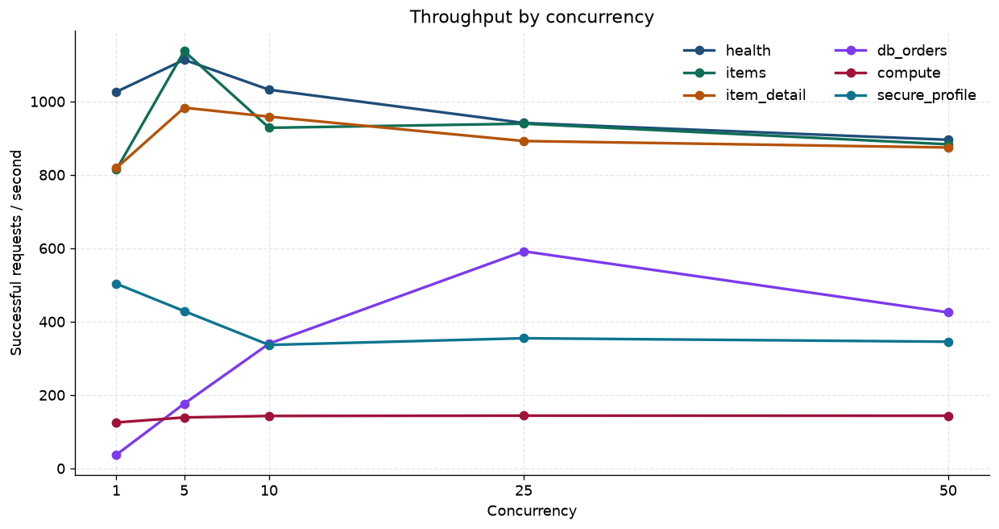
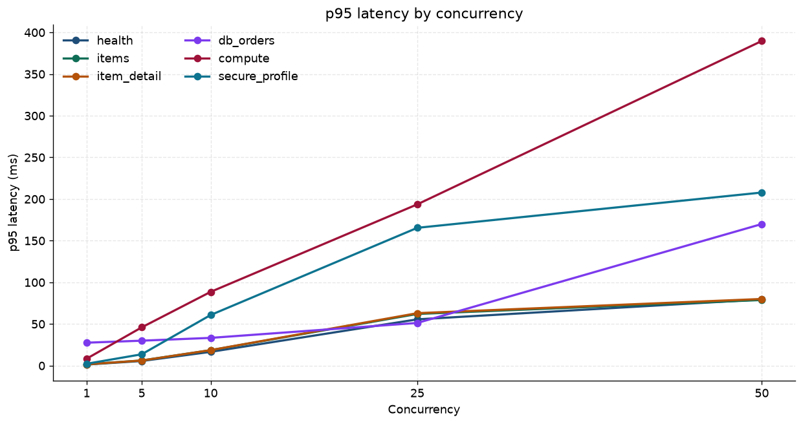
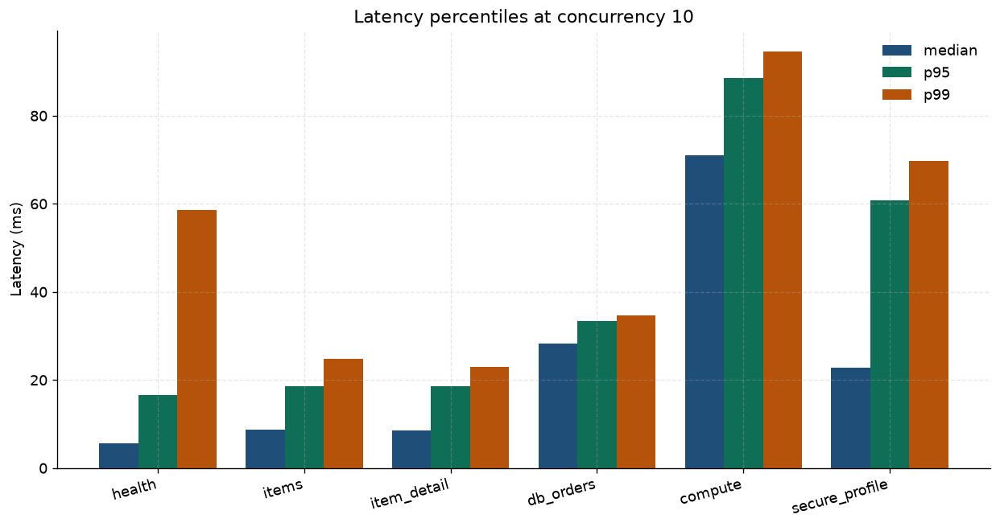
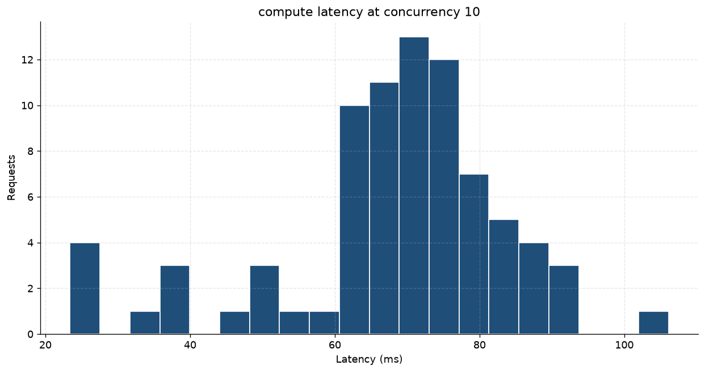
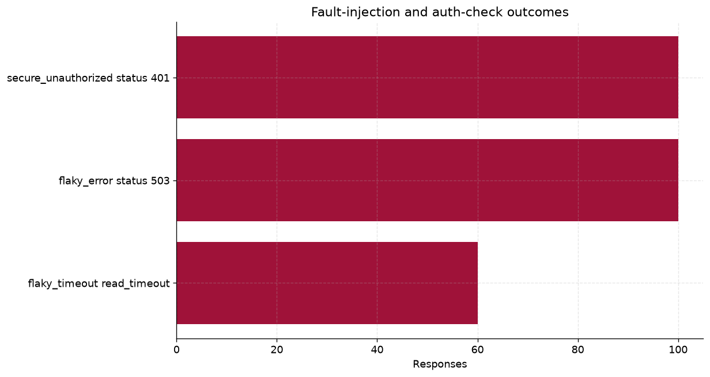
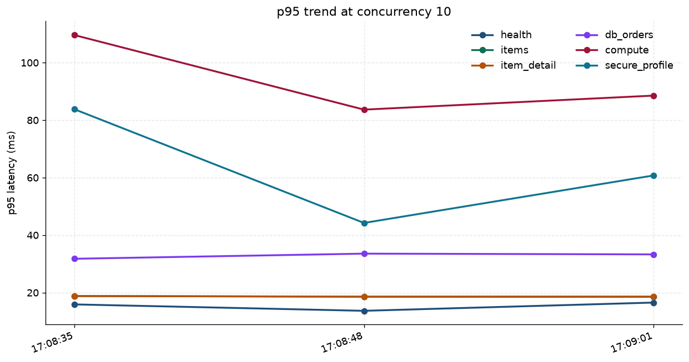

# Benchmark report: portfolio

Benchmark only systems you own or are authorized to test.

- Run: `20261108T170901652588Z`
- Target: `http://127.0.0.1:8000`
- Started: 2026-11-08T17:09:01.652Z
- Finished: 2026-11-08T17:09:13.278Z
- Warmup requests per endpoint: 5
- Default timeout: 5.00s
- Requests per level: 80
- Concurrency: 1, 5, 10, 25, 50

Local portfolio sweep across fast reads, an injected database delay, a CPU-bound digest, an authenticated call, an unauthorized check, and fault injection.

- Token acquisition: 16.93 ms

## Environment

- Python: 3.12.3
- Implementation: CPython
- Platform: Linux-6.12.113+-x86_64-with-glibc2.39
- Processor: Intel(R) Xeon(R) Processor
- Logical CPUs: 4
- Host: cursor

## Results

Latency columns are milliseconds for successful responses only. RPS is successful responses divided by the wall-clock time of that cell. Error % counts unexpected statuses and exceptions. stdev in the CSV and JSON is the sample standard deviation.

Highest p95 in this run was compute at concurrency 50: 389.63 ms. Lowest p95 was health at concurrency 1: 1.31 ms.

Highest throughput was items at concurrency 5: 1136.9 requests/s.

| Endpoint | Role | C | N | OK | Avg | Median | p90 | p95 | p99 | Min | Max | RPS | Error % |
| --- | --- | --- | --- | --- | --- | --- | --- | --- | --- | --- | --- | --- | --- |
| health | performance | 1 | 80 | 80 | 0.96 | 0.89 | 1.19 | 1.31 | 1.48 | 0.79 | 1.54 | 1026.0 | 0.0% |
| health | performance | 5 | 80 | 80 | 4.25 | 2.67 | 5.34 | 5.54 | 18.43 | 1.74 | 64.53 | 1113.4 | 0.0% |
| health | performance | 10 | 80 | 80 | 8.88 | 5.60 | 13.81 | 16.51 | 58.63 | 3.57 | 59.48 | 1031.7 | 0.0% |
| health | performance | 25 | 80 | 80 | 22.80 | 18.35 | 48.81 | 55.53 | 71.57 | 4.34 | 72.68 | 941.2 | 0.0% |
| health | performance | 50 | 80 | 80 | 40.28 | 39.74 | 73.96 | 79.43 | 84.42 | 3.85 | 84.61 | 895.3 | 0.0% |
| items | performance | 1 | 80 | 80 | 1.21 | 1.15 | 1.45 | 1.60 | 1.66 | 0.99 | 1.69 | 813.7 | 0.0% |
| items | performance | 5 | 80 | 80 | 4.08 | 3.35 | 5.95 | 6.18 | 10.35 | 2.33 | 20.58 | 1136.9 | 0.0% |
| items | performance | 10 | 80 | 80 | 9.88 | 8.80 | 17.40 | 18.53 | 24.79 | 3.78 | 27.34 | 928.0 | 0.0% |
| items | performance | 25 | 80 | 80 | 23.00 | 15.38 | 51.99 | 62.02 | 77.16 | 4.09 | 80.93 | 939.2 | 0.0% |
| items | performance | 50 | 80 | 80 | 41.26 | 41.40 | 69.55 | 78.75 | 86.27 | 5.00 | 87.16 | 883.0 | 0.0% |
| item_detail | performance | 1 | 80 | 80 | 1.21 | 1.14 | 1.46 | 1.54 | 1.71 | 0.97 | 1.77 | 818.1 | 0.0% |
| item_detail | performance | 5 | 80 | 80 | 4.82 | 3.03 | 5.91 | 6.11 | 22.05 | 2.49 | 76.25 | 982.8 | 0.0% |
| item_detail | performance | 10 | 80 | 80 | 9.55 | 8.60 | 16.65 | 18.58 | 22.97 | 3.76 | 24.23 | 958.4 | 0.0% |
| item_detail | performance | 25 | 80 | 80 | 24.24 | 17.63 | 53.36 | 62.95 | 76.51 | 4.46 | 83.80 | 892.0 | 0.0% |
| item_detail | performance | 50 | 80 | 80 | 41.45 | 43.08 | 77.60 | 80.00 | 87.01 | 4.77 | 87.26 | 874.3 | 0.0% |
| db_orders | performance | 1 | 80 | 80 | 27.09 | 27.02 | 27.29 | 27.50 | 28.19 | 26.72 | 28.27 | 36.9 | 0.0% |
| db_orders | performance | 5 | 80 | 80 | 27.99 | 27.77 | 29.14 | 29.93 | 30.68 | 26.60 | 30.84 | 176.1 | 0.0% |
| db_orders | performance | 10 | 80 | 80 | 28.73 | 28.18 | 30.56 | 33.28 | 34.58 | 26.82 | 35.74 | 339.9 | 0.0% |
| db_orders | performance | 25 | 80 | 80 | 36.17 | 34.04 | 48.37 | 51.22 | 57.94 | 26.59 | 58.97 | 591.5 | 0.0% |
| db_orders | performance | 50 | 80 | 80 | 92.89 | 79.53 | 163.71 | 169.94 | 178.86 | 33.22 | 186.30 | 424.9 | 0.0% |
| compute | performance | 1 | 80 | 80 | 7.99 | 7.96 | 8.17 | 8.32 | 8.62 | 7.44 | 9.27 | 125.0 | 0.0% |
| compute | performance | 5 | 80 | 80 | 35.37 | 36.31 | 42.71 | 45.94 | 52.97 | 14.50 | 54.23 | 138.7 | 0.0% |
| compute | performance | 10 | 80 | 80 | 68.05 | 70.99 | 85.43 | 88.52 | 94.54 | 23.41 | 106.11 | 142.7 | 0.0% |
| compute | performance | 25 | 80 | 80 | 167.93 | 180.64 | 192.63 | 193.58 | 198.00 | 17.82 | 200.00 | 143.5 | 0.0% |
| compute | performance | 50 | 80 | 80 | 295.60 | 342.44 | 386.51 | 389.63 | 394.31 | 65.38 | 394.39 | 143.3 | 0.0% |
| secure_profile | performance | 1 | 80 | 80 | 1.97 | 2.00 | 2.13 | 2.21 | 2.29 | 1.69 | 2.43 | 503.1 | 0.0% |
| secure_profile | performance | 5 | 80 | 80 | 11.07 | 6.91 | 13.51 | 13.60 | 52.62 | 5.37 | 184.34 | 428.4 | 0.0% |
| secure_profile | performance | 10 | 80 | 80 | 27.78 | 22.73 | 57.13 | 60.74 | 69.63 | 9.47 | 77.19 | 336.2 | 0.0% |
| secure_profile | performance | 25 | 80 | 80 | 60.68 | 46.44 | 124.21 | 165.39 | 184.06 | 15.25 | 208.89 | 354.5 | 0.0% |
| secure_profile | performance | 50 | 80 | 80 | 105.23 | 103.71 | 195.17 | 207.75 | 221.28 | 10.27 | 221.51 | 345.0 | 0.0% |
| secure_unauthorized | auth_check | 1 | 20 | 20 | 1.98 | 2.01 | 2.07 | 2.10 | 2.39 | 1.71 | 2.46 | 501.2 | 0.0% |
| secure_unauthorized | auth_check | 5 | 20 | 20 | 10.40 | 6.87 | 13.85 | 18.46 | 39.08 | 5.49 | 44.24 | 434.3 | 0.0% |
| secure_unauthorized | auth_check | 10 | 20 | 20 | 18.76 | 15.90 | 28.60 | 34.27 | 34.28 | 9.78 | 34.29 | 431.6 | 0.0% |
| secure_unauthorized | auth_check | 25 | 20 | 20 | 31.95 | 30.82 | 45.95 | 50.26 | 51.33 | 15.45 | 51.59 | 364.9 | 0.0% |
| secure_unauthorized | auth_check | 50 | 20 | 20 | 31.47 | 31.31 | 44.14 | 47.84 | 49.09 | 15.39 | 49.40 | 379.6 | 0.0% |
| flaky_error | fault | 1 | 20 | 20 | 2.09 | 2.08 | 2.39 | 2.43 | 2.44 | 1.80 | 2.45 | 475.8 | 0.0% |
| flaky_error | fault | 5 | 20 | 20 | 10.67 | 7.06 | 14.29 | 18.96 | 40.03 | 5.67 | 45.30 | 423.9 | 0.0% |
| flaky_error | fault | 10 | 20 | 20 | 19.22 | 16.43 | 28.91 | 35.25 | 35.39 | 10.15 | 35.42 | 422.2 | 0.0% |
| flaky_error | fault | 25 | 20 | 20 | 31.37 | 31.05 | 43.84 | 47.57 | 48.90 | 15.90 | 49.23 | 380.1 | 0.0% |
| flaky_error | fault | 50 | 20 | 20 | 31.73 | 31.39 | 44.28 | 48.40 | 49.58 | 16.32 | 49.88 | 376.1 | 0.0% |
| flaky_timeout | fault | 1 | 12 | 0 | n/a | n/a | n/a | n/a | n/a | n/a | n/a | 0.0 | 100.0% |
| flaky_timeout | fault | 5 | 12 | 0 | n/a | n/a | n/a | n/a | n/a | n/a | n/a | 0.0 | 100.0% |
| flaky_timeout | fault | 10 | 12 | 0 | n/a | n/a | n/a | n/a | n/a | n/a | n/a | 0.0 | 100.0% |
| flaky_timeout | fault | 25 | 12 | 0 | n/a | n/a | n/a | n/a | n/a | n/a | n/a | 0.0 | 100.0% |
| flaky_timeout | fault | 50 | 12 | 0 | n/a | n/a | n/a | n/a | n/a | n/a | n/a | 0.0 | 100.0% |

## Throughput comparison

| Endpoint | p95 @ 1 | p95 @ 10 | p95 @ 50 | RPS @ 1 | RPS @ 10 | RPS @ 50 |
| --- | --- | --- | --- | --- | --- | --- |
| health | 1.31 | 16.51 | 79.43 | 1026.0 | 1031.7 | 895.3 |
| items | 1.60 | 18.53 | 78.75 | 813.7 | 928.0 | 883.0 |
| item_detail | 1.54 | 18.58 | 80.00 | 818.1 | 958.4 | 874.3 |
| db_orders | 27.50 | 33.28 | 169.94 | 36.9 | 339.9 | 424.9 |
| compute | 8.32 | 88.52 | 389.63 | 125.0 | 142.7 | 143.3 |
| secure_profile | 2.21 | 60.74 | 207.75 | 503.1 | 336.2 | 345.0 |

## Status and exception breakdown

| Endpoint | Kind | Key | Count |
| --- | --- | --- | --- |
| health | status | 200 | 400 |
| items | status | 200 | 400 |
| item_detail | status | 200 | 400 |
| db_orders | status | 200 | 400 |
| compute | status | 200 | 400 |
| secure_profile | status | 200 | 400 |
| secure_unauthorized | status | 401 | 100 |
| flaky_error | status | 503 | 100 |
| flaky_timeout | exception | read_timeout | 60 |

## Baseline comparison

A latency regression requires p95 to increase by more than 20% and more than 5 ms. A throughput regression requires a drop of more than 15% and more than 1 requests/s.

No metrics regressed beyond the configured thresholds.

| Endpoint | C | Metric | Baseline | Current | Delta | Status |
| --- | --- | --- | --- | --- | --- | --- |
| health | 1 | p95_ms | 1.28 | 1.31 | +2.0% | ok |
| health | 1 | throughput_rps | 1012.80 | 1025.99 | +1.3% | ok |
| health | 5 | p95_ms | 5.72 | 5.54 | -3.2% | ok |
| health | 5 | throughput_rps | 1161.01 | 1113.39 | -4.1% | ok |
| health | 10 | p95_ms | 15.88 | 16.51 | +4.0% | ok |
| health | 10 | throughput_rps | 1077.01 | 1031.74 | -4.2% | ok |
| health | 25 | p95_ms | 59.89 | 55.53 | -7.3% | ok |
| health | 25 | throughput_rps | 943.88 | 941.19 | -0.3% | ok |
| health | 50 | p95_ms | 80.43 | 79.43 | -1.2% | ok |
| health | 50 | throughput_rps | 882.77 | 895.32 | +1.4% | ok |
| items | 1 | p95_ms | 1.44 | 1.60 | +11.5% | ok |
| items | 1 | throughput_rps | 830.12 | 813.67 | -2.0% | ok |
| items | 5 | p95_ms | 6.09 | 6.18 | +1.5% | ok |
| items | 5 | throughput_rps | 1035.05 | 1136.85 | +9.8% | ok |
| items | 10 | p95_ms | 18.80 | 18.53 | -1.4% | ok |
| items | 10 | throughput_rps | 964.60 | 927.99 | -3.8% | ok |
| items | 25 | p95_ms | 57.77 | 62.02 | +7.3% | ok |
| items | 25 | throughput_rps | 904.87 | 939.22 | +3.8% | ok |
| items | 50 | p95_ms | 80.66 | 78.75 | -2.4% | ok |
| items | 50 | throughput_rps | 867.58 | 883.01 | +1.8% | ok |
| item_detail | 1 | p95_ms | 1.51 | 1.54 | +2.4% | ok |
| item_detail | 1 | throughput_rps | 824.33 | 818.13 | -0.8% | ok |
| item_detail | 5 | p95_ms | 6.28 | 6.11 | -2.7% | ok |
| item_detail | 5 | throughput_rps | 1098.37 | 982.77 | -10.5% | ok |
| item_detail | 10 | p95_ms | 18.76 | 18.58 | -1.0% | ok |
| item_detail | 10 | throughput_rps | 918.49 | 958.37 | +4.3% | ok |
| item_detail | 25 | p95_ms | 63.45 | 62.95 | -0.8% | ok |
| item_detail | 25 | throughput_rps | 884.88 | 891.95 | +0.8% | ok |
| item_detail | 50 | p95_ms | 80.66 | 80.00 | -0.8% | ok |
| item_detail | 50 | throughput_rps | 883.57 | 874.30 | -1.0% | ok |
| db_orders | 1 | p95_ms | 27.36 | 27.50 | +0.5% | ok |
| db_orders | 1 | throughput_rps | 36.83 | 36.88 | +0.1% | ok |
| db_orders | 5 | p95_ms | 30.14 | 29.93 | -0.7% | ok |
| db_orders | 5 | throughput_rps | 173.74 | 176.11 | +1.4% | ok |
| db_orders | 10 | p95_ms | 31.75 | 33.28 | +4.8% | ok |
| db_orders | 10 | throughput_rps | 337.96 | 339.86 | +0.6% | ok |
| db_orders | 25 | p95_ms | 50.35 | 51.22 | +1.7% | ok |
| db_orders | 25 | throughput_rps | 606.92 | 591.50 | -2.5% | ok |
| db_orders | 50 | p95_ms | 174.88 | 169.94 | -2.8% | ok |
| db_orders | 50 | throughput_rps | 413.59 | 424.85 | +2.7% | ok |
| compute | 1 | p95_ms | 8.77 | 8.32 | -5.2% | ok |
| compute | 1 | throughput_rps | 121.42 | 124.97 | +2.9% | ok |
| compute | 5 | p95_ms | 47.28 | 45.94 | -2.8% | ok |
| compute | 5 | throughput_rps | 132.45 | 138.67 | +4.7% | ok |
| compute | 10 | p95_ms | 109.58 | 88.52 | -19.2% | ok |
| compute | 10 | throughput_rps | 132.61 | 142.70 | +7.6% | ok |
| compute | 25 | p95_ms | 201.86 | 193.58 | -4.1% | ok |
| compute | 25 | throughput_rps | 137.62 | 143.53 | +4.3% | ok |
| compute | 50 | p95_ms | 489.37 | 389.63 | -20.4% | improvement |
| compute | 50 | throughput_rps | 124.86 | 143.29 | +14.8% | ok |
| secure_profile | 1 | p95_ms | 2.30 | 2.21 | -3.7% | ok |
| secure_profile | 1 | throughput_rps | 490.57 | 503.13 | +2.6% | ok |
| secure_profile | 5 | p95_ms | 13.78 | 13.60 | -1.3% | ok |
| secure_profile | 5 | throughput_rps | 425.75 | 428.38 | +0.6% | ok |
| secure_profile | 10 | p95_ms | 83.78 | 60.74 | -27.5% | improvement |
| secure_profile | 10 | throughput_rps | 302.61 | 336.24 | +11.1% | ok |
| secure_profile | 25 | p95_ms | 159.99 | 165.39 | +3.4% | ok |
| secure_profile | 25 | throughput_rps | 369.56 | 354.49 | -4.1% | ok |
| secure_profile | 50 | p95_ms | 212.42 | 207.75 | -2.2% | ok |
| secure_profile | 50 | throughput_rps | 338.36 | 345.05 | +2.0% | ok |

## Charts

Throughput across concurrency levels for performance endpoints.

p95 latency across concurrency levels for performance endpoints.

Median, p95, and p99 at one concurrency level.

Latency distribution for the slowest performance endpoint at that level.

Fault-injection and auth-check outcomes summed across the sweep.

p95 latency across saved runs at one concurrency level.

## How to read a cell

Warmup requests are discarded. Percentiles use linear interpolation between the closest ranks. A fault endpoint that is configured to time out can legitimately record zero successes when `allow_zero_success` is set.
